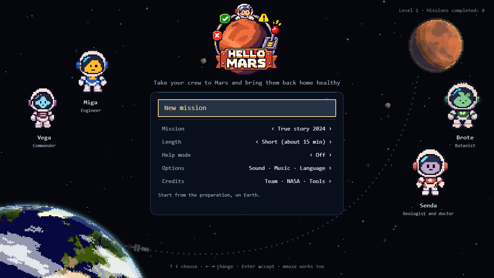
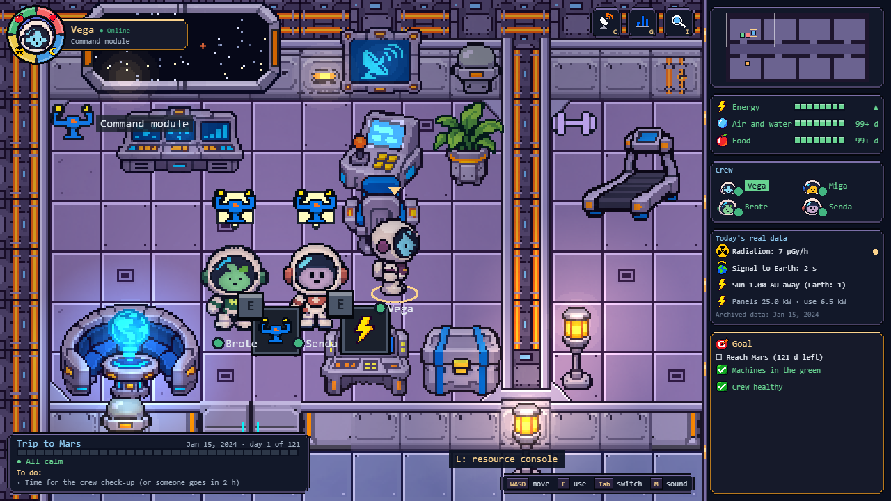
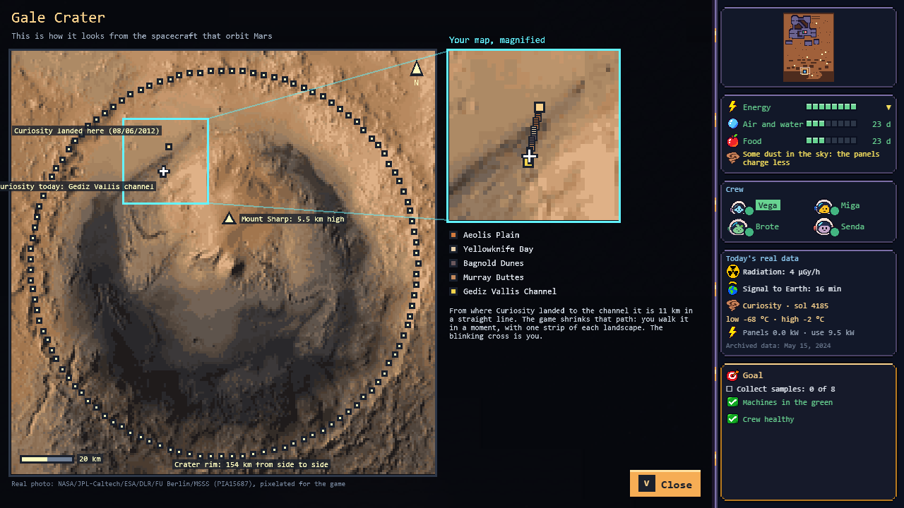
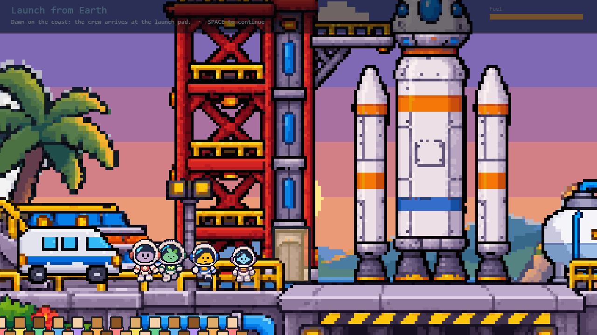

# Hello Mars



**Hello Mars** is a 2D top-down mission game for kids aged 7 to 12, made for the
[NASA Space Apps Challenge 2026](https://www.spaceappschallenge.org/2026/challenges/junior-astronaut-mission-trainer/)
challenge *Junior Astronaut Mission Trainer*. The player commands a crew of four on a round trip to Mars: they pack
the ship, launch, cross deep space, land in Gale Crater, live and work there for 20 sols, and bring everyone home
safe.

Everything that happens comes from **real NASA data from 2024**: the radiation BioSentinel and Curiosity measured,
the solar storms DONKI recorded, the dust and cold REMS saw at Gale, and the signal delay given by the real distance
between the planets. When a real event arrives, the game pauses and shows a "This really happened" card with the date
and the source.

Playable in Spanish and English. Runs in any modern browser, offline, with keyboard and mouse.

## The mission

| Step | What the player does |
| --- | --- |
| Packing | Fit food, water, shielding and spare parts into the cargo hold. Every choice has a cost. |
| Launch from Earth | Go / No-Go checklist and a chain of stage minigames: fuel, boarding, pressurizing, radio check, countdown, booster and stage separation, turning toward orbit. |
| Trip to Mars (121 days) | Run the ship: keep machines working, care for the crew, cook, exercise, and get everyone into the shelter when a solar storm hits. |
| Landing on Mars | Atmospheric entry, parachute, heat shield separation and descent engines down to Gale Crater. |
| Life on Mars (20 sols) | Walk outside to collect rock samples across five real landscapes (Aeolis plain, Yellowknife Bay, Bagnold dunes, Murray buttes, Gediz Vallis), clean the solar panels, run MOXIE, fix breaches, cables and fuses. |
| Trip home | Pack the samples, launch from Mars, cross space again, re-enter and splash down on Earth. |
| Report | Stars for crew health, radiation dose and samples brought home, the real daily dose chart, achievements. |

| | |
| --- | --- |
|  |  |
|  | **Game modes**: *Real story 2024* replays the 2024 events in order; *Free mode* uses different real dates on each leg. Short (~15 min) or long (~30 min) missions, an optional help mode, and unlockable levels. Progress can be saved at any time. |

### Controls

| Where | Keys |
| --- | --- |
| Ship and Mars base | **WASD / arrows** move · **E** use (opens each room's minigame) · **Tab** switch crew member · **1 2 3** answer an incident · **Z** sleep in bed · **I** full status · **C** Mission Control · **G** data panel · **M** mute · **Esc** pause |
| Mars only | **V** crater map · **E** (hold) collect samples outside · **F** start the trip home once all samples are collected |
| Minigames | On-screen tutorial for each one · **Q** leave |
| Maneuvers | Arrows and **Enter** on the checklist · **Space** (or click) at the right moment of each stage |
| Menus | Arrows, **Enter**, or the mouse |

There are 15 room minigames: exercise bike, CO2 scrubber, water recycler, call home, star navigation, medical check,
ship kitchen, storm shelter, plants, greenhouse harvest, MOXIE, seals, leak patch, fuses and cable splicing.

## Real NASA data

All data is archived in [`datasets/`](datasets/README.md), so the game works offline; each card shows the real date
of the data it uses.

| Data | Used for |
| --- | --- |
| DONKI (flares, solar particles, notifications) | Storm warnings with their real lead time, radio blackouts, Mission Control messages |
| RadLab: BioSentinel, Curiosity RAD, Artemis I, ExoMars TGO | Daily radiation dose in space and on Mars, real storm peaks, crossing the Van Allen belts |
| Curiosity REMS | Daily dust (solar panel power) and cold (heating) at Gale |
| JPL planetary positions and solar conjunctions | Signal delay to Mission Control, days without contact |
| NASA-STD-3001, BVAD, OSDR | Oxygen, water, food, CO2, exercise and dose limits; science facts shown in game |
| Photojournal, Blue Marble, Viking MDIM | Gale Crater map and the spinning Earth and Mars on the menu |

Full credits, licenses and how each source is used: [`CREDITS.md`](CREDITS.md) (also in the game: main menu → Credits).

## Running it

Requires Node.js 22.

```bash
npm install
npm run dev        # http://localhost:5173
npm test           # unit tests, including a full 2024 campaign played in Node
npm run build      # type check + production build in dist/
```

### Deploying

The repo includes a `Dockerfile` (Node build, nginx serving `dist/`) and a `docker-compose.yml` ready for
[Dokploy](https://dokploy.com) or any Docker host:

```bash
docker compose up --build   # serves the game on the container's port 80
```

On Dokploy: create a Compose service pointing to this repo, then add a domain for service `web`, port `80`.

## Project structure

```
src/
├── core/       Game rules, pure TypeScript (no Phaser): clock, meters, crew, incidents, ship and base sessions,
│               maneuvers, cargo, report, save. Fully tested in Node.
├── data/       The only entry point to datasets/: series, storms, timeline, orbits.
├── content/    Design data: 2024 campaign, ship and Gale maps (Tiled JSON), incidents, crew, credits.
├── i18n/       Spanish and English texts.
└── game/       Phaser 4 layer: scenes, rendering, input, audio. No rules live here.
datasets/       Archived NASA data with its catalogue and sources.
public/assets/  Game art and audio (each folder has a README on how it was made).
scripts/        Data download and processing, art pipeline, map builders, music mastering.
art/            Art sources: prompts, raw generations, snapped sheets.
docs/           Game design, production logs, closed plans and visual references (index in docs/README.md).
```

Stack: Phaser 4.2, TypeScript 7 (strict), Vite 8, Vitest 5. Architecture rules (checked by tests) and development
notes — scene URL parameters, art pipeline, gotchas — are in [`AGENTS.md`](AGENTS.md).

## Team

Made by **Santiago** (ship and base simulation) and **Facundo** (mission flow and maneuvers).

AI tools were used under the team's direction and are credited in [`CREDITS.md`](CREDITS.md): Devin (coding
assistant), Lyria (music), ElevenLabs (sound effects), OpenAI Image 2.5 (base images for sprites) and Sprite Fusion
Pixel Snapper (pixel clean-up).

Hello Mars is not an official NASA product and is not endorsed by NASA.

## License

The code and the team's own assets are released under the [MIT License](LICENSE). NASA data and images are public
domain or used with credit, and third-party tools keep their own licenses; see [`CREDITS.md`](CREDITS.md).
